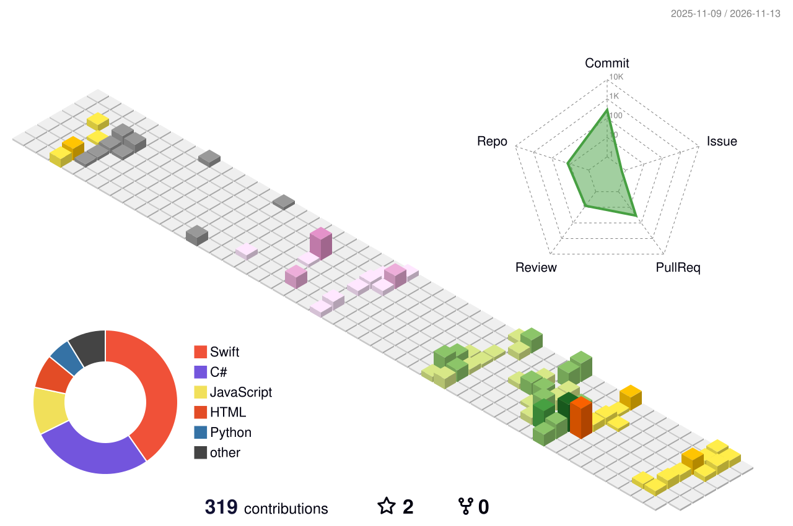

<picture>
  <source media="(prefers-color-scheme: dark)" srcset="banner-dark.svg">
  <source media="(prefers-color-scheme: light)" srcset="banner-light.svg">
  
</picture>

  <picture>
    <source media="(prefers-color-scheme: dark)" srcset="roles-dark.svg">
    <source media="(prefers-color-scheme: light)" srcset="roles-light.svg">
    
  </picture>

I build machine learning systems and the software around them — the model, the API, the interface, and the thing that finally gets deployed. Computer Science undergraduate at **BINUS University**, Research Assistant across NLP and computer vision, and a developer at the **Apple Developer Academy**, where most of my recent work is in Swift: augmented reality, real-time simulation and learning apps on iPhone and iPad.

Most of what I enjoy sits at the seam: taking something that only worked in a notebook and making it survive contact with real users.

## whoami

  <picture>
    <source media="(prefers-color-scheme: dark)" srcset="terminal-dark.svg">
    <source media="(prefers-color-scheme: light)" srcset="terminal-light.svg">
    
  </picture>

## What I build

  <picture>
    <source media="(prefers-color-scheme: dark)" srcset="what-i-build-dark.svg">
    <source media="(prefers-color-scheme: light)" srcset="what-i-build-light.svg">
    
  </picture>

## Tools

  <picture>
    <source media="(prefers-color-scheme: dark)" srcset="https://skillicons.dev/icons?i=swift,py,c,cs,java,js,ts,r,dart,php,tensorflow,pytorch,sklearn,react,nodejs,express,django,fastapi,laravel,flutter,unity,arduino,mongodb,mysql,git,github,vercel,figma&theme=dark&perline=14">
    <source media="(prefers-color-scheme: light)" srcset="https://skillicons.dev/icons?i=swift,py,c,cs,java,js,ts,r,dart,php,tensorflow,pytorch,sklearn,react,nodejs,express,django,fastapi,laravel,flutter,unity,arduino,mongodb,mysql,git,github,vercel,figma&theme=light&perline=14">
    
  </picture>

  <picture>
    <source media="(prefers-color-scheme: dark)" srcset="marquee-dark.svg">
    <source media="(prefers-color-scheme: light)" srcset="marquee-light.svg">
    
  </picture>

## By the numbers

  <picture>
    <source media="(prefers-color-scheme: dark)" srcset="stats-dark.svg">
    <source media="(prefers-color-scheme: light)" srcset="stats-light.svg">
    
  </picture>

  <picture>
    <source media="(prefers-color-scheme: dark)" srcset="https://github-profile-summary-cards.vercel.app/api/cards/profile-details?username=LukasMystic&theme=github_dark&animation=load">
    <source media="(prefers-color-scheme: light)" srcset="https://github-profile-summary-cards.vercel.app/api/cards/profile-details?username=LukasMystic&theme=github&animation=load">
    
  </picture>

  <picture>
    <source media="(prefers-color-scheme: dark)" srcset="https://github-profile-summary-cards.vercel.app/api/cards/repos-per-language?username=LukasMystic&theme=github_dark&animation=draw">
    <source media="(prefers-color-scheme: light)" srcset="https://github-profile-summary-cards.vercel.app/api/cards/repos-per-language?username=LukasMystic&theme=github&animation=draw">
    
  </picture>
  <picture>
    <source media="(prefers-color-scheme: dark)" srcset="https://github-profile-summary-cards.vercel.app/api/cards/most-commit-language?username=LukasMystic&theme=github_dark&animation=draw">
    <source media="(prefers-color-scheme: light)" srcset="https://github-profile-summary-cards.vercel.app/api/cards/most-commit-language?username=LukasMystic&theme=github&animation=draw">
    
  </picture>

  <picture>
    <source media="(prefers-color-scheme: dark)" srcset="profile-3d-contrib/profile-night-view.svg">
    <source media="(prefers-color-scheme: light)" srcset="profile-3d-contrib/profile-season-animate.svg">
    
  </picture>

## Selected work

### Apple platforms

| Project | What it does |
| :-- | :-- |
| **[JataYuk](https://github.com/LukasMystic/JataYuk)** SwiftUI, ARKit, RealityKit, Metal | An AR science lab for kids. Place the elephant-toothpaste experiment on a real table, change the yeast, peroxide and temperature, and watch the foam respond. The foam is a GPU fluid simulation (SPH) written in Metal, meshed every frame, with the app built on a small Composable Architecture core. |
| **[Cubby](https://github.com/LukasMystic/Cubby)** SwiftUI, SpriteKit, AVFoundation, TipKit | A storybook game that teaches young children about consent and personal boundaries. A page-curl storybook leads into a small world you walk with a joystick, where each character tells you how they like to be greeted. |
| **[Zen Buddy](https://github.com/LukasMystic/Zen-Buddy)** SwiftUI, RealityKit, ARKit, Speech | An AR dog that responds to your voice. Say sit, shake, roll over or play dead, and on-device speech recognition triggers the animation, with barks timed to each move. |

### AI and research

| Project | What it does |
| :-- | :-- |
| **[MSLSAM](https://github.com/LukasMystic/MSLSAM)** PyTorch, Transformers, Llama 3, Qwen3 | My undergraduate thesis: catching prompt injection by reading an LLM's own hidden states during the forward pass it already runs. Every version is pre-registered and now evaluated against an adaptive attacker, with attack success checked on real generations. |
| **[Political Sentiment AI](https://sentiment-analysis-llm.vercel.app)** Python, Llama 3, RAG, React, Node | Scrapes YouTube and Reddit, labels multilingual sentiment, and has Llama 3 write a sourced report you can then question through a chatbot. A RAG layer keeps every claim traceable to a real post. |
| **[Poverty clusters in Java](https://github.com/LukasMystic/java-poverty-lisa-sensitivity)** R, spatial statistics | Two papers accepted at ICoDiT 2026 (Springer CCIS) showing how the choice of spatial neighbours and permutation count changes which poverty clusters you find across Java's 119 regencies. Every table reproduces byte for byte from one script. |
| **[Stacking ensemble for sentiment](https://www.sciencedirect.com/science/article/pii/S1877050925027139)** scikit-learn, TF-IDF, SMOTE | Research I led: a stacking ensemble that raises decision-tree accuracy on sentiment classification. Accepted at ICCSCI 2025, published in Elsevier Procedia Computer Science. |
| **[Building damage detection](https://stanleypt.vercel.app/project/68d419a9bbccb9a17094d400)** TensorFlow, U-Net, Attention, SAM | Post-disaster segmentation and damage classification on Maxar satellite imagery, in a doctoral research team. 95.3% peak footprint accuracy. |
| **[Alzheimer's MRI benchmark](https://stanleypt.vercel.app/project/68d3e8037cabee5eb7243543)** TensorFlow, EfficientNet, ResNet, Grad-CAM | Five pre-trained CNNs benchmarked on the same MRI pipeline, weighing accuracy against compute cost and Grad-CAM explainability. |
| **[ObjectDet](https://github.com/LukasMystic/objectdet)** PyTorch, FastAPI, React, MongoDB | Object recognition with a dual-teacher distillation method: ResNet-18 and EfficientNet-B0 teach a lightweight student, with an SVM on top. |
| **[DoodleDetect](https://github.com/jesslyntrixie/doodledetect)** CLIP, PCA, SVM, Tkinter | Sketch and image recognition from CLIP features, PCA and an SVM. Beats a VGG-16 baseline with no retraining and no GPU loop. |

### Games and hardware

| Project | What it does |
| :-- | :-- |
| **[The Red Door](https://github.com/LukasMystic/TheRedDoor)** Unity 6, C# | A short, deliberately hard 2D boss fight about resilience. Difficulty comes from shorter recovery windows rather than shorter warnings, so the fight stays learnable. |
| **[FAHHH?](https://github.com/LukasMystic/FAHHH-)** ESP32, MQTT, Python | A wearable device that guides blind and low-vision passengers through Jakarta train stations, built for Samsung Innovation Campus. I own connectivity, the companion dashboard and testing. |

### Full-stack and web

| Project | What it does |
| :-- | :-- |
| **[Reviving Wringinanom](https://github.com/LukasMystic/Project-Wringinanom)** Web, RAD | Tourism platform for Desa Wisata Wringinanom, built leading a team of 10 on a RAD cycle. Credited with an 8% rise in village tourism. |
| **[HIMTI Bootcamp 2025](https://github.com/LukasMystic/HIMTIBOOTCAMP2025)** MERN | Registration and participant-tracking platform for HIMTI's annual bootcamp. |
| **[LnT GitReady](https://github.com/LukasMystic/LnTGitReady)** TypeScript, React | Workshop platform for BNCC's Learning and Training division. |
| **[BNCC final project](https://github.com/LukasMystic/BNCC-Final-Project)** PHP, Laravel, MySQL | Back-end track final project, with the highest score in the region, and the only team to reach that level. |

Earlier work, including [CeritaNusa](https://github.com/LukasMystic/ceritanusa), [cross-domain sentiment analysis](https://github.com/LukasMystic/Sentiment-Analysis) and coursework in C, is in the repository list.

## Techniques

The parts of the work that do not come with a logo.

<picture>
  <source media="(prefers-color-scheme: dark)" srcset="techniques-dark.svg">
  <source media="(prefers-color-scheme: light)" srcset="techniques-light.svg">
  
</picture>

## Currently

<picture>
  <source media="(prefers-color-scheme: dark)" srcset="currently-dark.svg">
  <source media="(prefers-color-scheme: light)" srcset="currently-light.svg">
  
</picture>

## Elsewhere

  <a href="https://stanleypt.vercel.app"><b>Portfolio</b></a>&emsp;&emsp;
  <a href="https://linkedin.com/in/stanley-pratama-teguh"><b>LinkedIn</b></a>&emsp;&emsp;
  <a href="https://github.com/LukasMystic"><b>GitHub</b></a>&emsp;&emsp;
  <a href="mailto:lukasstanley42@gmail.com"><b>Email</b></a>

<picture>
  <source media="(prefers-color-scheme: dark)" srcset="https://raw.githubusercontent.com/LukasMystic/LukasMystic/output/snake-dark.svg">
  <source media="(prefers-color-scheme: light)" srcset="https://raw.githubusercontent.com/LukasMystic/LukasMystic/output/snake.svg">
  
</picture>
